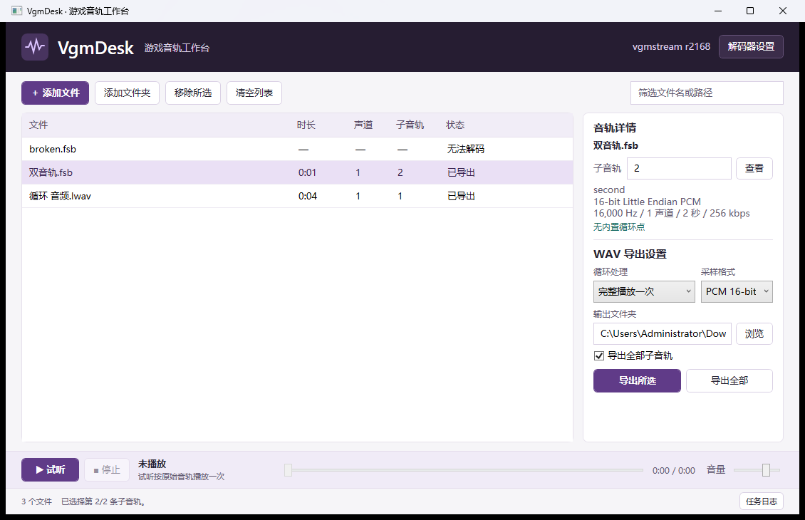

# VgmDesk 1.0 · 游戏音轨工作台

[](https://github.com/umeabc/VgmDesk/actions/workflows/build.yml)
[](https://github.com/umeabc/VgmDesk/releases/latest)
[](LICENSE)

**[下载 Windows x64 免安装版](https://github.com/umeabc/VgmDesk/releases/latest)** · 完整解压后双击 `VgmDesk.exe`



参照 [VGMGUI](https://github.com/BENICHN/VGMGUI) 的队列、试听和批量转换流程，独立实现的简体中文 Windows 桌面 GUI。免安装版内置 GitHub 于 2026-11-20 查询到的最新正式版 [vgmstream r2168](https://github.com/vgmstream/vgmstream/releases/tag/r2168)，直接运行 `vgmstream-cli.exe`，不用改名，也不需要 VLC 或另装 .NET。

## 开始使用

1. 将 Windows x64 ZIP **完整解压**到任意目录，双击 `VgmDesk.exe`。保留同级 `vgmstream` 文件夹及其 DLL。
2. 拖入文件或文件夹，或使用「添加文件 / 添加文件夹」。文件夹按解码器报告的扩展名递归扫描（也尝试无扩展名文件）；其他扩展名可单独添加。多文件格式所需的配套文件应留在原位置。
3. 选中条目查看详情。若有多个子音轨，输入 1 起始的编号并点「查看」，再试听。队列列出的时长和声道是第一条子音轨的原始值。试听播放一次，最多双声道；可暂停、拖动进度、调音量。试听会先解码到临时目录，不改动原文件。
4. 选择 WAV 输出目录、采样格式和循环处理方式，再点「导出所选」或「导出全部」。默认导出每个文件的全部子音轨，多子音轨文件以 `_001`、`_002` 等编号；取消「导出全部子音轨」则按每个文件当前选中的编号导出。同名输出自动追加编号，不覆盖已有文件。输出保留源声道数。

### 循环选项

- **完整播放一次**：忽略循环点，导出完整原始音轨。
- **循环后淡出**：按指定次数循环，等待指定延迟后淡出。
- **循环后播放尾部**：循环指定次数，再播放原始尾部，不淡出。
- **写入循环点**：将已有循环点写入 WAV 的 `smpl` 块；是否循环取决于播放软件。

解码失败时可打开「任务日志」查看 CLI 返回的信息。批次可以取消，已完成的 WAV 会保留。「导出全部」不受搜索筛选影响。快捷键：`Ctrl+O` 添加、`Delete` 移除队列项、`Ctrl+空格` 试听或暂停。

## 更换解码器

从 [vgmstream Releases](https://github.com/vgmstream/vgmstream/releases/latest) 下载新版 Windows 压缩包，完整解压到单独目录，然后在「解码器设置」选择其中的 `vgmstream-cli.exe`。GUI 会重新验证版本、读取扩展名列表并分析已添加文件。需要支持 `-V` 和 `-m -I` JSON 输出的 CLI。GUI 不会自动联网更新。

## 构建与验证

在 Windows 上安装 .NET 10 SDK，再运行：

```powershell
dotnet build src/VgmDesk.csproj -c Release
dotnet publish src/VgmDesk.csproj -c Release -r win-x64 --self-contained -p:PublishSingleFile=true -p:IncludeNativeLibrariesForSelfExtract=true -p:EnableCompressionInSingleFile=true -p:DebugType=None -o out
```

将官方 Windows x64 CLI 压缩包解压到 `out\vgmstream`，或者启动后手动选择解码器。

```powershell
python tests/fixtures.py .work/fixtures
dotnet run --project tests/EngineSmoke.csproj -- out/vgmstream/vgmstream-cli.exe .work/fixtures
```

`tests/DesktopSmoke.ps1` 可在 Windows 桌面下验证导入、子音轨、批量导出和试听控件，接受 `-App`（应用路径）、`-Fixtures`（样本目录）、`-Workspace`（测试输出目录）三个绝对路径。此脚本会尝试写入一张窗口截图。

## 第三方组件

- [vgmstream r2168 源码](https://github.com/vgmstream/vgmstream/tree/r2168) · [Windows x64 官方二进制包](https://github.com/vgmstream/vgmstream/releases/download/r2168/vgmstream-win64.zip)。二进制包 SHA-256：`692d45070852a35c1fa42726aa3c9de528e44eec925d37d99b1074256b99a229`。
- 官方 CLI 与 DLL 未修改。其版权声明随包保留；编解码依赖的[许可文本](https://github.com/vgmstream/vgmstream/tree/r2168/ext_libs/licenses)和[对应源代码、构建配置说明](https://github.com/vgmstream/vgmstream/blob/r2168/doc/BUILD-LIB.md)见上游，含 [FFmpeg n9.0.2](https://github.com/FFmpeg/FFmpeg/tree/n9.0.2)、[mpg123 1.33.7](https://sourceforge.net/projects/mpg123/files/mpg123/1.33.7/)。
- 免安装包同时收录 .NET 运行时与 WPF 的许可文本。
